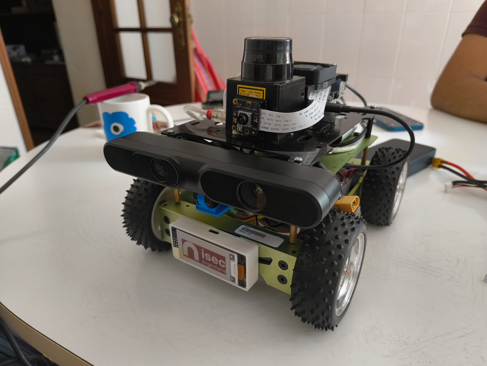
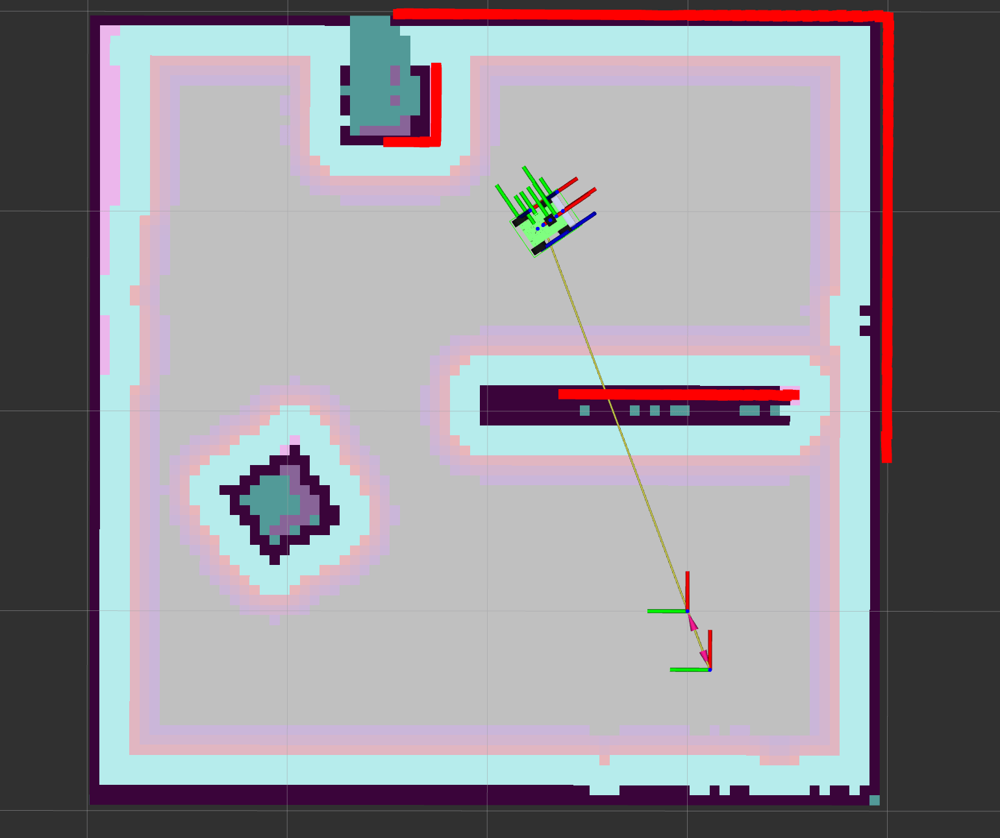

## Autores

- [@José Craveiro](https://github.com/Malicancas)

- [@Guilherme Filipe](https://github.com/guilassas)


# S.U.C.A.T.A 2.0 - Sistema Unificado de Cartografia Autónoma e Tracking de ArUco

**SUCATA** é um robô de 4 rodas desenvolvido com o framework **ROS 2 Jazzy**, projetado para simulação no **Gazebo Harmonic** e controlo via `ros2_control`. O projeto tem como objetivo facilitar testes, integração de sensores (como LIDAR e câmara para leitura de marcadores ArUco) e diferentes métodos de operação.

## Demonstração

<p float="center">
  
  
</p>

## 📃 Estado do Projeto

- Robô configurado e simulado no Gazebo ✅
    - Controlo funcional via `teleop_keyboard` ✅
    - Controlo funcional via `Nunchuck` ✅
    - Navegação ✅
    - SLAM ✅
    - Câmara de profundidade - Sem integração na Navegação por agora
    - Deteção ArUco - Algoritmo de docking precisa de ser trabalhado
    - YOLO11n - Algoritmo precisa de trabalho


## 📦 Pacotes Externos Utilizados

- [**LIDAR**](https://github.com/Hokuyo-aut/urg_node2) (`urg_node2`)
- [**Marcadores ArUco**](https://github.com/JMU-ROBOTICS-VIVA/ros2_aruco) (`ros2_aruco`)
- [**Asus Xtion Pro**](https://github.com/ros-drivers/openni2_camera) (`openni2_camera`)

## 💥 Lista de Componentes
Componentes utilizados neste projeto:

| | Componente |
| --| --|
|1| Raspberry Pi 4B (4 GB)|
|2| Cartão SD SanDisk 32 GB (mínimo)|
|3| [Skeleton Bot 4WD hercules mobile robotic platform](https://wiki.seeedstudio.com/Skeleton_Bot-4WD_hercules_mobile_robotic_platform/)|
|4| [IMU MPU6050](https://pt.aliexpress.com/item/1005008404467219.html?src=google&pdp_npi=4@dis!EUR!1.92!1.38!!!!!@!12000044896717467!ppc!!!&gQT=2)|
|5| LiDAR URG-04LX|
|6| Módulo de câmara Raspberry Pi 3|
|7| Asus Xtion Pro|
|8| Ventoinha 50mm 12V|
|9| [Suporte de ventoinha 50mm](https://www.printables.com/model/443438-raspberry-pi-4-bracket-for-50mm-fan)|
|10| Bateria LiPo 4S 2400mAh 14.8V|
|11| Nunchuck modificado (ver repositório Nunchuck)|
|12| Dock USB com alimentação externa|
|13| Router TPLink MR3020 (opcional)|


## Instalação
Os comandos seguintes assumem que o utilizador já possui um ambiente ROS2 funcional e Gazebo Harmonic, consulte a [documentação](https://docs.ros.org/en/jazzy/index.html) para mais informações.

**Configuração da simulação:**
```bash
# Criar workspace
mkdir -p ros2ws/src
cd ros2ws/src

# Clonar repositório principal
git clone https://github.com/Malicancas/sucata

# Instalar dependências
rosdep install --from-paths src --ignore-src -r -y

# Seguir os passos para instalar o Gazebo Harmonic
https://gazebosim.org/docs/harmonic/install_ubuntu/

```
**Compilação e simulação:**
```bash
# Dentro da pasta /ros2ws
colcon build --symlink-install
source install/setup.bash
export GZ_SIM_RESOURCE_PATH=~/my-local-models/
ros2 launch sucata launch_sim.launch.py
```

**Configuração do Raspberry Pi:**

Para as configurações seguintes, é recomendado conectar-se ao Raspberry Pi através de uma conexão SSH.

```bash
mkdir -p ros2ws/src
cd ros2ws/src

# Clonar o branch RPI
git clone --single-branch --branch RPI https://github.com/Malicancas/sucata.git

# Pacote para deteção ArUco
git clone https://github.com/JMU-ROBOTICS-VIVA/ros2_aruco.git

# Pacote para LiDAR
git clone https://github.com/Hokuyo-aut/urg_node2.git

# Pacote para câmara de profundidade
git clone https://github.com/ros-drivers/openni2_camera

```


**Para uso do controlador BLE (Nunchuck):**

Clone o repositório mencionado abaixo e siga as instruções.
```bash
git clone https://github.com/Malicancas/nunchuck-BLE
```
